<!-- GitHub profile README. Graphics are self-hosted SVGs in assets/ and respect prefers-reduced-motion. -->

  

I'm **Nidhi**, a Computer Engineering student at **DJ Sanghvi, Mumbai**, and I build AI that people can actually trust inside real products.
At Engaze I built the assistant that works inside a production college ERP. It picks the right tool from **400+ MCP tools** without loading
them all into context, and **nothing changes until a person confirms it**. Along the way I closed an IDOR on placement routes that nobody
had assigned me, built an RBAC-first, ABAC-fallback access matrix, and wrote **121 tests** for the assistant services, because "it worked on my prompt" isn't a test.

  

### the evidence tap a card

  
  
  
  
  
  

### the stack

  <b>languages</b> 
  

  <b>frontend &amp; mobile</b> 
  

  <b>backend &amp; data</b> 
  

  <b>ship it</b> 
  

  
  
  
  
  
  
  
  
  
  
  

  

  <a href="https://nidhimaru.vercel.app">portfolio</a> ·
  <a href="https://www.linkedin.com/in/nidhimaru/">LinkedIn</a> ·
  <a href="mailto:nidhimaru19@gmail.com">nidhimaru19@gmail.com</a>

<!-- TODO: link "SN Works" to the SN Works site once it is live -->

my SN Works co-founder and hackathon teammate, who names everything after soup → <a href="https://github.com/Soham-Prajapati"><b>@Soham-Prajapati</b></a>

